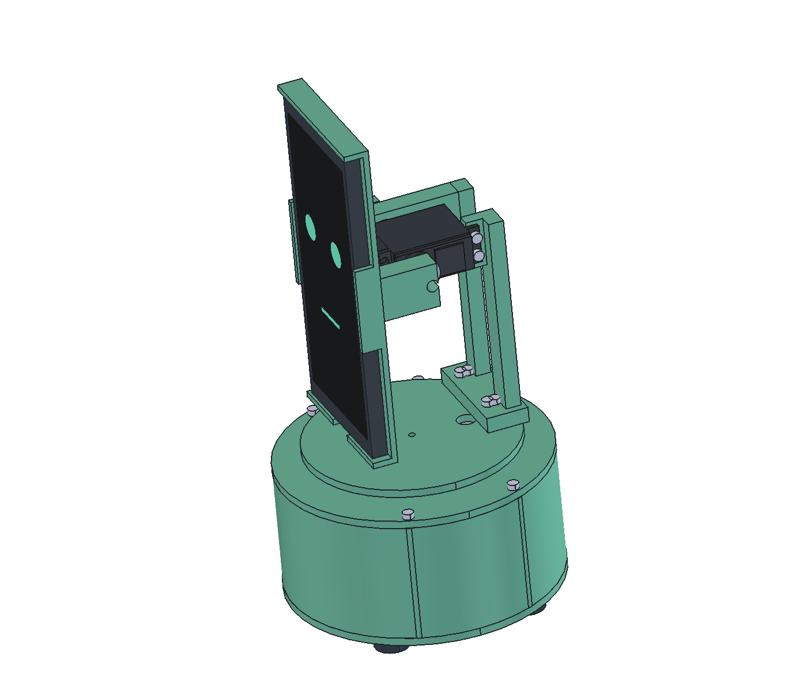

# Androsaur Stand

Чертежи и CAD-модели корпуса моторизованной подставки Androsaur.

## Организация проекта

[Структура файлов и работа с моделями](docs/project-organization.md) описывает
хранение деталей, покупных компонентов, сборок, чертежей и комплектов для изготовления.
Документ содержит предложенную схему; конструктивные решения и размеры требуют проверки.

## Открыть макет

Главный файл — [cad/assemblies/stand.FCStd](cad/assemblies/stand.FCStd).
Открывайте его вместе с полным деревом репозитория: детали подгружаются
через внешние ссылки. Макет построен в FreeCAD 1.1.4.

- [Как открыть, двигать и редактировать модель](docs/working-with-model.md)
- [Требования владельца по итогам интервью](docs/requirements.md)
- [Названия деталей, сборок и экземпляров](docs/part-names.md)
- [Принятая для макета конструкция и допущения](docs/design.md)
- [Оси и интерфейсы](docs/interfaces.md)
- [Состав изделия](docs/bom.csv)
- [Отчёт проверок](docs/verification-report.json)
- [Полная сборка STEP](cad/assemblies/exports/stand.step)
- [Вид сбоку](cad/assemblies/exports/stand-side.png)
- [Положение с поворотом и наклоном](cad/assemblies/exports/stand-pose.png)
- [Открытое основание](cad/assemblies/exports/stand-cutaway.png)
- [Исходный концепт](references/concepts/androsaur-stand-v3.svg)
- [Каталог оригиналов и правила их хранения](references/README.md)
- [Сервопривод по чертежу 352944](cad/components/servo-reference/README.md)

Это первый полный макет с допущениями, предназначенный для редактирования
и примерок. Качалки, соединения и электроника пока условные;
экспорты деталей не являются проверенным комплектом для производства.
