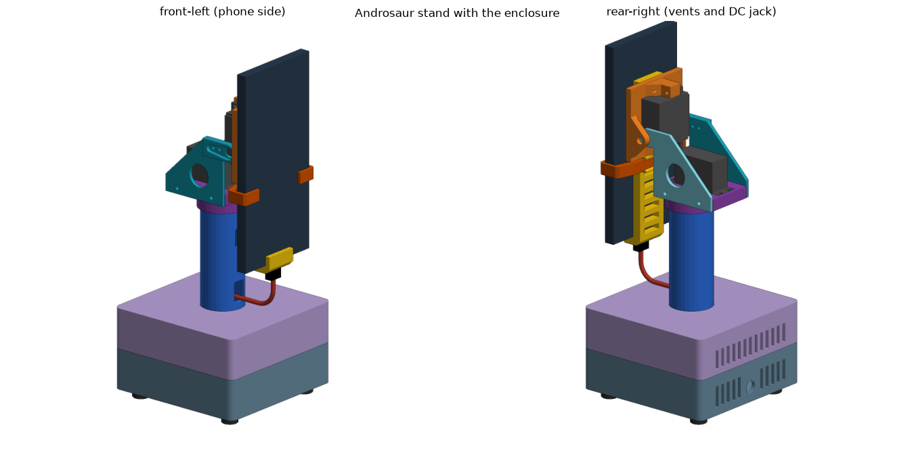

# Androsaur Stand

Моторизованная подставка для старого Android-телефона: два серво MG996R (поворот и наклон),
полая ножка для проводов, двухдетальный держатель телефона и корпус электроники 125 × 125 мм
с динамиком, ESP32, усилителем и блоком питания. Часть проекта [Androsaur](https://github.com/androsaurs).

Модель параметрическая, написана на **Python / build123d** (BRep, не сетка) и лежит в [`cadpy/`](cadpy/).
Прежняя модель во FreeCAD удалена из рабочего дерева; она осталась в истории git (коммит `9d254f3`).



## Состояние

Рабочий черновик для экспериментов, не готовый к печати комплект.

| Узел | Состояние |
| --- | --- |
| Поворотно-наклонный механизм | Собран и проверен на пересечения: наклон −2…100°, поворот 45–180° |
| Держатель телефона (спинка + захват под Redmi 12: 76,3 × 9,0 мм) | Параметрический, разъём Type-C и кабель смоделированы; щель с зазорами 0,5 мм по бокам и 0,8 мм по толщине, пробная печать не сделана |
| Корпус 125 × 125 × 70, две половины | Построен, подставка висит под крышкой, ножка выходит через отверстие в крышке |
| Динамик FD92-1, полка, ESP32, усилитель, ЦАП | Размещены; размеры плат оценочные, кроме габаритов |
| Блок питания | Пока куб-заглушка 60 × 38 × 26 мм, модуль не выбран |
| Устойчивость | Стоит, но запас небольшой, нужен балласт ([проверки](docs/verification.md)) |
| Прошивка, проводка, пробная печать | Не сделаны |

Подробности и открытые вопросы — в [docs/open-issues.md](docs/open-issues.md).

## Быстрый старт

```bash
cd cadpy
python3 -m venv .venv && .venv/bin/pip install -r requirements.txt
./viewer.sh                       # просмотрщик http://127.0.0.1:3939/viewer, перерисовка при сохранении view.py
.venv/bin/python check.py -2 45 90 100   # проверка пересечений при наклоне
.venv/bin/python export.py        # STEP для FreeCAD и друзей -> exports/androsaur-stand-assembly.step
.venv/bin/python export_stl.py    # STL деталей механизма и держателя для печати -> exports/stl/
.venv/bin/python shots.py         # картинки для документации -> docs/img/
```

Подробнее: [docs/model-guide.md](docs/model-guide.md).

## Что где лежит

| Путь | Что это |
| --- | --- |
| [`cadpy/pantilt.py`](cadpy/pantilt.py) | Механизм, основание, ножка и сборка `assemble()` всей модели |
| [`cadpy/clip_holder.py`](cadpy/clip_holder.py) | Держатель телефона из двух деталей, штекер и кабель Type-C |
| [`cadpy/enclosure.py`](cadpy/enclosure.py) | Корпус, полка, ножки корпуса, вентиляция, вход питания |
| [`cadpy/speaker.py`](cadpy/speaker.py), [`esp32.py`](cadpy/esp32.py), [`amp.py`](cadpy/amp.py) | Габариты динамика, платы ESP32, усилителя, ЦАП, блока питания |
| [`cadpy/check.py`](cadpy/check.py), [`pancheck.py`](cadpy/pancheck.py) | Проверка пересечений при наклоне и повороте |
| [`cadpy/view.py`](cadpy/view.py), [`palette.py`](cadpy/palette.py) | Живой просмотр и цвета деталей |
| [`cadpy/export.py`](cadpy/export.py), [`shots.py`](cadpy/shots.py) | Экспорт в STEP, картинки |
| [`exports/`](exports/) | STEP сборки и проект FreeCAD с той же геометрией (для просмотра и обмена); [`exports/stl/`](exports/stl/): STL деталей для печати |
| [`references/`](references/README.md) | Источники сторонних материалов (micromet, MG996R, держатель) |
| [`docs/`](docs/) | Документация |

## Документация

- [Конструкция](docs/design.md): механизм, держатель, ножка, параметры
- [Корпус и компоновка](docs/enclosure.md): размеры, координаты, порядок сборки, печать
- [Крепёж](docs/fasteners.md): что и сколько купить
- [Печать](docs/printing.md): STL по деталям, как класть, что печатать первым, настройки
- [Электроника](docs/electronics.md): состав, питание, усилитель, серво, что искать в магазине
- [Проверки](docs/verification.md): зазоры, пересечения, устойчивость, печатаемость
- [Открытые вопросы](docs/open-issues.md)
- [Работа с моделью](docs/model-guide.md)
- [Системы координат](docs/interfaces.md)
- [Названия деталей](docs/part-names.md), [состав](docs/bom.csv)
- [Требования](docs/requirements.md)

## Лицензия

Собственные материалы — [CC BY-NC-SA 4.0](LICENSE). Геометрия механизма восстановлена по исходникам
micromet (Thingiverse 1941574, CC BY-SA) и сохраняет их лицензию. У модели MG996R и держателя телефона,
переданных владельцем, условия авторов не сообщены. Подробности рядом с источниками в `references/`.
