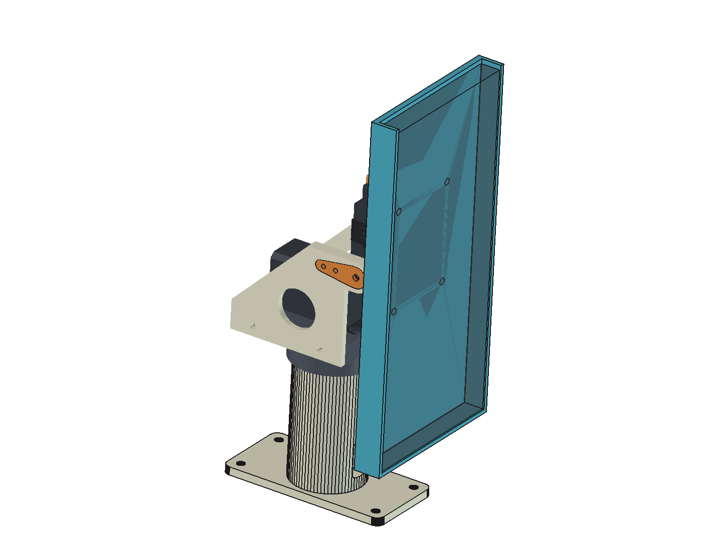

# Androsaur Stand

Подставка с двумя MG996R, полой ножкой для проводов и держателем телефона.
В рабочем дереве оставлена только принятая владельцем конструкция.

Открыть **[cad/assemblies/stand.FCStd](cad/assemblies/stand.FCStd)** вместе со всем
деревом проекта. Каждая сборка и деталь открывается отдельной вкладкой FreeCAD.

| Что открыть | Для чего |
| --- | --- |
| [stand.FCStd](cad/assemblies/stand.FCStd) | Общая компоновка из подсборок |
| [pan-tilt.FCStd](cad/assemblies/pan-tilt.FCStd) | Механизм с основанием и двумя серво |
| [phone-holder.FCStd](cad/assemblies/phone-holder.FCStd) | Держатель с макетом телефона |
| [base.FCStd](cad/parts/base/base.FCStd) | Редактирование ножки, полости и кабельных окон |
| [mg996r.FCStd](cad/components/mg996r/mg996r.FCStd) | Общий компонент для обоих серво |

Детали хранятся в `cad/parts/`, покупные компоненты — в `cad/components/`.
Сборки содержат ссылки, а не копии исходной геометрии. Новый корпус электроники
позже получит собственную подсборку и будет подключён к общей модели по интерфейсу.

- [Организация моделей](docs/project-organization.md)
- [Как редактировать и компоновать](docs/working-with-model.md)
- [Опорные системы координат](docs/interfaces.md)
- [Названия деталей](docs/part-names.md)
- [Текущая конструкция и ограничения](docs/design.md)
- [Принятые требования](docs/requirements.md)
- [Состав](docs/bom.csv)
- [Источники](references/README.md)

Состояние до очистки сохранено в Git: метка `before-modular-layout`, коммит
`9d254f3`. Удалённые эксперименты доступны там; заново создавать их не нужно.

Собственные материалы — [CC BY-NC-SA 4.0](LICENSE). Геометрия micromet и её
производные сохраняют исходную CC BY-SA; лицензия проекта их не заменяет.
У переданной модели MG996R условия автора не сообщены. Подробности рядом с источниками.
