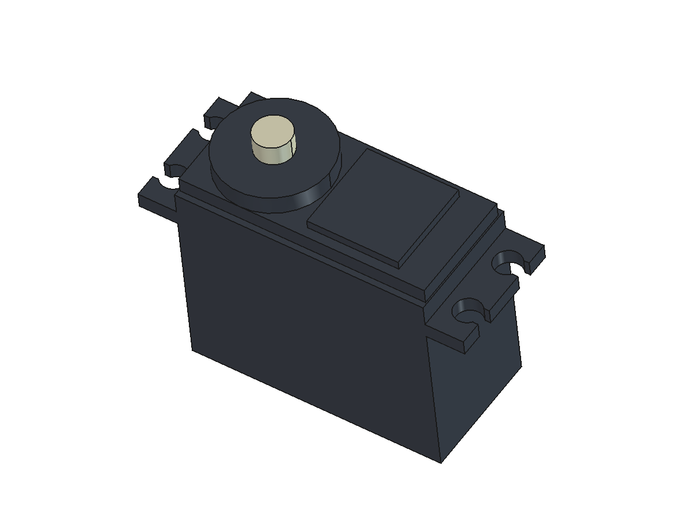

# Androsaur Stand

Чертежи и CAD-модели корпуса моторизованной подставки Androsaur.

## Компоненты

- [Сервопривод по чертежу 352944](cad/servo-352944/README.md):
  параметрическая модель FreeCAD, STEP, макрос и превью.

Размеры модели редактируются в таблице `Dimensions` документа FreeCAD.
Для воспроизведения откройте `cad/servo-352944/build_servo.FCMacro` в FreeCAD
и запустите макрос: файлы сохраняются рядом с ним.
Допущения и ограничения указаны в описании компонента.
