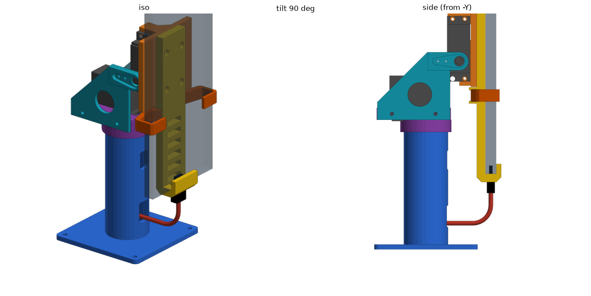

# Конструкция

Единицы — мм. Модель собирается функцией `assemble()` в [`cadpy/pantilt.py`](../cadpy/pantilt.py). Система координат —
в [interfaces.md](interfaces.md), названия деталей — в [part-names.md](part-names.md).

## Механизм поворота и наклона

Параметрическая перестройка механизма micromet / Thingiverse 1941574 (CC BY-SA) по его OpenSCAD-исходникам
(`references/pan-tilt-1941574`). Два серво MG996R, габарит построен по STL владельца: корпус 40 × 19, уши 54 × 3, бобышка Ø13,
шлиц Ø5,6. Серво — габаритная заглушка, не точная модель.

- Нижнее серво поворачивает всё вокруг вертикальной оси (круглая качалка `base`, корпус серво в `carrier`).
- Верхнее серво наклоняет площадку `platform` вокруг оси вдоль Y; с другой стороны площадка опирается на выступ боковины.
- Свободный ход наклона по модели: примерно от −2° до 101°: внизу серво касаются друг друга (при толщине серво 20 мм), вверху кабель касается основания. Положительный угол
  больше 90° — наклон вперёд. 0° — площадка горизонтально, 90° — вертикально, лицом к +X.

## Основание и ножка (`base`)

| Параметр | Значение | Комментарий |
| --- | --- | --- |
| Подошва | 85 × 85 × 4 | в SCAD была 85 × 42; ножка по центру |
| Высота ножки `RISER` | 104 | в SCAD 12; нужна, чтобы кабель телефона дошёл до окна зарядки |
| Наружный радиус ножки | 18,2 (Ø36,4) | точный цилиндр |
| Полость | R15,2, стенка 3 | открыта снизу сквозь подошву |
| Окна | зарядка 12 × 18 на 0,25 высоты, моторы 10 × 16 на 0,75 | R2, на фасаде +X |
| Отверстия подошвы | 4 × Ø4 в углах, отступ 6 | крепление к корпусу |

Высота ножки выбрана так, чтобы прямой штекер Type-C с изгибом кабеля R15 встретил окно зарядки при вертикальной позе.
Угловой штекер позволил бы ножку около 60 мм (не принято).

## Площадка и держатель телефона

- `platform` по всей площади утолщена до 6 мм со стороны держателя (`MOUNT_PAD = 3`): иначе её нельзя напечатать плоскостью вниз без
  поддержек и в неё не войдут винты спинки. Глухие пилоты Ø2,6 × 4,5 мм под винты M3×8 спинки находятся между блоками серво:
  по оси платформы x = −18 и 15, y = −15 и 5. Винты идут со стороны телефона, гаек нет.
- Площадка расширена так, чтобы её центр совпадал с центром основания; положение опоры не менялось.
- Держатель из двух деталей: `body` (спинка, 105,6 мм, плоская сзади, два выступа-направляющих) и `grip` (U-образный захват под
  телефон 76,3 мм). Построены параметрически по STL владельца ([`cadpy/clip_holder.py`](../cadpy/clip_holder.py)); автор и
  лицензия исходной модели неизвестны. Исходный захват был на телефон 82 мм: щель переделана под телефон владельца
  (ширина между стенками 77,3 мм, щель по толщине 9,8 мм; см. ниже).
- Телефон — Xiaomi Redmi 12 (23053RN02Y) без чехла: габарит 168,6 × 76,3 × 9,0 (высота и ширина по GSMArena, ширина подтверждена
  владельцем; толщина 9,0 измерена владельцем, в характеристиках 8,2, щель считается от измеренной). Зазоры в `clip_holder.py`:
  `FIT_SIDE` 0,5 мм с каждой стороны, `FIT_THICK` 0,8 мм в сумме (FDM печатает пазы на 0,2–0,3 мм уже; подобрать по пробной
  печати). Телефон стоит посередине щели по толщине (зазор 0,4 мм к плите и к губе спинки); нижним краем он упирается в торцевую
  стенку. Ось наклона проходит по середине высоты телефона; `HOLDER_SLIDE` −8,7 мм сохраняет прежнее положение спинки.
- Штекер Type-C (`plug`, корпус 12 × 6,5 × 16, металл 8,4 × 2,6) и жёсткий макет кабеля (`cable`, Ø3,6, прямой участок 10, изгиб R15,
  хвост 30), чтобы проверять путь кабеля и зазоры.

## Подошва под крышкой

Основание не стоит на корпусе, а **висит под крышкой**: подошва прижата к низу верхней половины (крышка 8 мм), ножка выходит
вверх через отверстие Ø37. Снаружи видна только ножка. Винты M3×6 подошвы идут снизу (головка утоплена в подошву, углубление Ø6,4 × 2,5 мм) в слепые отверстия Ø2,6 глубиной 6 мм в
крышке, верх крышки сплошной. Подробнее — в [enclosure.md](enclosure.md), крепёж — в [fasteners.md](fasteners.md).

## Что не сделано

- Серво — габарит, не точная модель; крепёж, шлицы, посадки качалок, удержание телефона, прочность и печать не проверены.
- Окно Type-C в нижнем упоре держателя есть; настоящий кабель и его изгиб проверены только на жёсткой заглушке.
- Проверка пересечений охватывает пары деталей в позах −2…100° (см. [verification.md](verification.md)).
