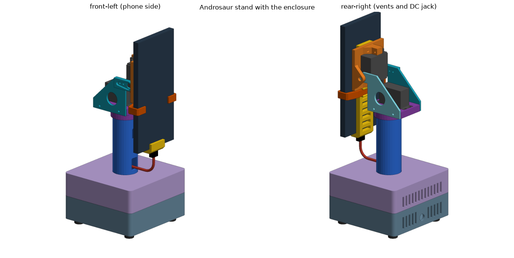
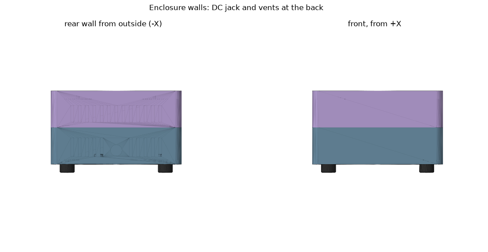
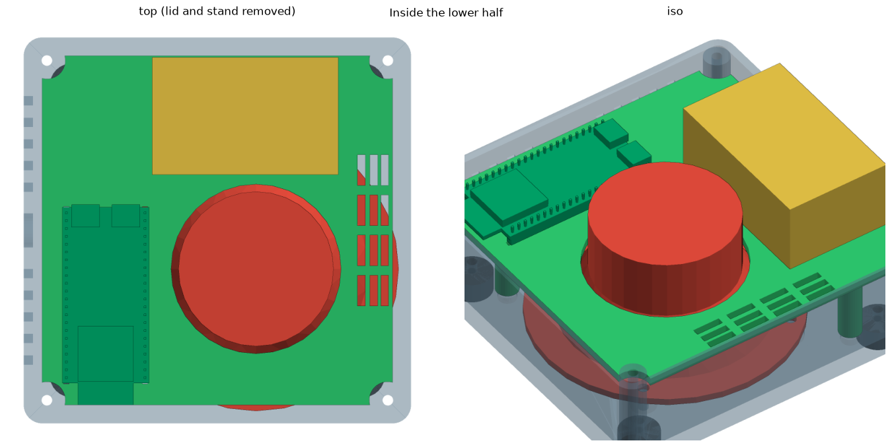
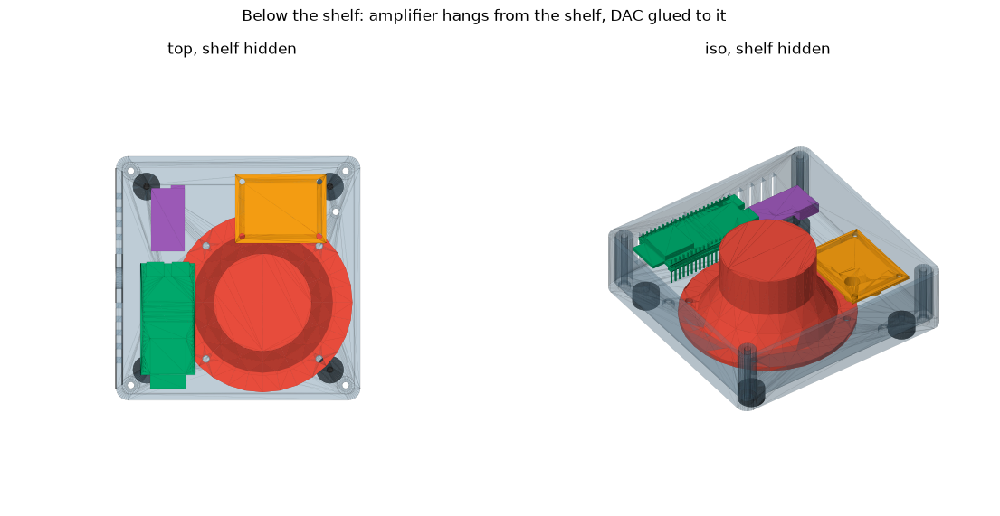

# Корпус и компоновка

Файл [`cadpy/enclosure.py`](../cadpy/enclosure.py). Все числа — черновые значения по умолчанию, их меняют константами в начале файла.
Координаты ниже — в системе корпуса: начало в центре корпуса по X и Y, Z — от низа дна (0) до верха крышки (70).
**+X — к телефону (передняя стенка), задняя стенка со входом питания и вентиляцией на −X.** В мировой системе модели
ось ножки подставки в точке (42,5; 42,5), низ подошвы подставки z = 0, низ корпуса z = −58, низ ножек корпуса z = −66.

## Две половины

Корпус 125 × 125 × 70 разрезан пополам по горизонтальной плоскости на высоте 35 мм (`SEAM_Z`).

| Часть | Что в ней |
| --- | --- |
| `box_lower` | Дно 4 мм, стенки 3 мм, четыре угловые стойки Ø9 с отверстием Ø3,4 и тоннелем Ø6,4 глубиной 31 мм **снизу**, стойки динамика, решётка под динамиком, отверстия под ножки корпуса и ножки полки, вход питания и нижние щели в задней стенке |
| `box_upper` | Потолок 8 мм, стенки 3 мм, стойки с отверстиями Ø2,6 глубиной 10 под самонарезные винты M3, шпунтовое кольцо (4 × 2 мм, зазор 0,3), ступенька 2 мм, на которой кольцо висит, отверстие Ø37 под ножку, глухие отверстия Ø2,6 × 6 под винты подошвы, верхние щели |

Сборка: четыре винта **M3×12** (головка не шире Ø6,4: ISO 7380 Ø5,7, DIN 912 Ø5,5, DIN 7985 Ø5,6) вставляются **снизу** в тоннель Ø6,4
внутри нижней стойки глубиной 31 мм (`POST_CBORE_DEPTH`, считается из длины винта `JOIN_SCREW_L` = 12 и входа в пилот `JOIN_ENGAGE` = 8).
Головка упирается в потолок тоннеля на высоте 31 мм, конец винта входит в пилот верхней стойки на 8 мм. Стенка стойки вокруг тоннеля
1,3 мм; над головкой остаются 4 мм сплошной стойки. Нужен шестигранник или бита с вылетом не короче 35 мм. Угловые стойки стоят
вплотную к стенкам. Длина винта меняется одной константой: другая длина — другая глубина тоннеля.

**Подставка под крышкой.** Подошва 85 × 85 висит под потолком верхней половины (потолок 8 мм), ножка Ø36,4 выходит наверх через
отверстие Ø37. Винты M3×6 подошвы идут снизу, головка утоплена в подошву (углубление Ø6,4 × 2,5 мм), в слепые пилоты Ø2,6 × 6 мм в потолке. Верх крышки сплошной, без отверстий под винты.

## Содержимое

| Деталь | Положение | Заметки |
| --- | --- | --- |
| Динамик FD92-1 | Угол +X / −Y: центр (12,5; −12,5), лицом вниз на четырёх стойках Ø9 × 5 | Фланец Ø92, магнит Ø50 × 22, высота 42, диффузор Ø75, четыре отверстия Ø4 на окружности Ø82 (**допущение**). Под ним в полу решётка из прорезей 3 мм с шагом 6, радиус 34. Между полом и фланцем **кольцо** (по окружности болтов динамика: центр радиуса 41, стенка 39,5–42,5 мм, толщина 3, высота 5): звук из передней полости выходит только через решётку наружу, а не в корпус. Верх кольца касается фланца, для герметичности положить ленточный поролон или прокладку |
| Полка `shelf` | Низ плиты на 27,5 мм, плита 113 × 113 × 3 | Отверстие Ø54,9 вокруг магнита (зазор 1,5 мм до конуса), три ножки Ø8 в точках (50; 34), (−30; −45), (−38,5; 0), 12 щелей 2,5 × 10 у переднего края. Верх плоский |
| ESP32 | На полке, центр по X −36, антенна у стенки −Y, гнёзда USB смотрят внутрь | Штыри проходят в щели полки и висят под ней |
| Усилитель TPA3118 | Под полкой, повёрнут: 46,5 по X, 35 по Y, X от −14,25 до 32,25 (центр 9, как у блока питания), Y от 21,5 до 56,5 (3 мм до стенки) | Четыре стойки Ø6 × 3 с пилотами Ø2,6 (винты снизу) |
| ЦАП PCM5102A | Под полкой, на задней стороне, Y от 14 до 47,5, X от −44,5 до −27,5 | Приклеивается термоклеем, креплений нет |
| Блок питания HW-674 (XL4005) | Модуль 60 × 38 × 26 на верхней стороне полки, X от −21 до 39, Y от 18 до 56, на печатных втулках 3 мм | Радиаторы стоят у края +Y, за подошвой подставки (зазор до неё 0,5 мм). Четыре винта M3×8 сверху через плату и втулки в плиту, под плитой столбики Ø5,5 × 2,5 (верх полки остаётся плоским). Компоненты на плате оценочные, отверстия по углам с отступом 3,5 мм тоже |
| Ножки корпуса | Четыре Ø14 × 8 в точках (±47; ±47) | Отдельные детали, винт M3×6 изнутри (головка в углублении Ø6,4 × 2,5 мм в полу) через пол в слепое отверстие ножки |

В видах сверху задняя стенка слева, перед справа.

## Крепёж

Два размера M3 и один M4: **M3×6** (усилитель, ножки полки, ножки корпуса, подошва подставки — 15 шт), **M3×12** (стяжка половин корпуса и
спинка держателя — 8 шт, к спинке гайки и шайбы по 4 шт), **M4×8** (динамик, 4 шт). Все головки утоплены в углубления Ø6,4.
Таблица, длины, что купить и что не определено — в [fasteners.md](fasteners.md).

## Вход питания и вентиляция

- Вход: отверстие Ø11 под панельное гнездо 5,5 × 2,1 мм в задней стенке на Y = 0 и высоте 13 мм над низом корпуса.
- Нижняя половина: 10 щелей 3 мм с шагом 7 мм по Y = ±14…±42 на высоте 7–25 мм, **ниже полки**.
- Верхняя половина: 13 щелей на Y = 0…±42, высота 40–56 мм.
- Полка: 12 щелей 2,5 × 10 у переднего края напротив задних щелей. Воздух входит внизу сзади, идёт под полкой над усилителем,
  поднимается через щели полки и уходит через верхние задние щели над блоком питания.

## Печать без поддержек

| Деталь | Положение |
| --- | --- |
| `box_lower` | Дном вниз |
| `box_upper` | Потолком вниз (перевёрнутой), юбка вверх |
| `shelf` | Плитой вниз, ножками и стойками усилителя вверх (**верх полки обязательно плоский**) |
| Ножки корпуса | Любой стороной |
| Подошва и ножка подставки, механизм | См. [verification.md](verification.md) |

Мелкие свесы: цековки под головки винтов (мосты 6,4 мм), полочки шпунта. Остальное печатается без поддержек.

## Параметры, которые чаще всего меняют

`BOX_H`, `WALL`, `SPK_X`/`SPK_Y` (угол динамика), `SHELF_DROP` (насколько ниже плита, предел задаёт усилитель под ней),
`SHELF_LEGS`, `TPA_X`/`TPA_Y0`, `FOOT_POS`, `JACK_*`, `LOWER_VENT_Z`/`UPPER_VENT_Z`, `SHELF_VENT_*`.
После правки запускать `check.py` и смотреть результат в просмотрщике.
