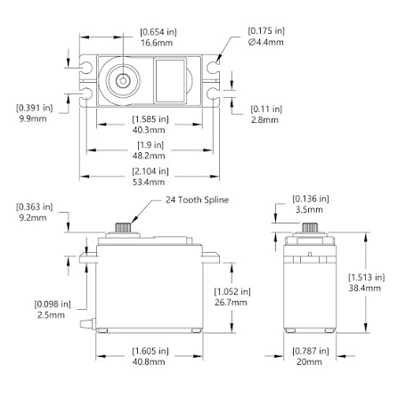

# Исходный чертёж сервопривода 352944

- Локальный оригинал: [drawing-352944.jpg](drawing-352944.jpg).
- Источник: https://forum.freecad.org/download/file.php?id=352944.
- Идентификатор вложения на форуме: `352944`.
- Получен: 2026-10-25 при работе над моделью; сохранена та же копия,
  по которой строился исходный сервопривод.
- Формат: JPEG, 447×447 пикселей, 28 034 байта.
- SHA-256: `b93b37ec9bfee6755bb78dd4994105f10cbd94dd0de980ece0908c226f1644ba`.
- Имя файла у автора, автор, производитель и точный артикул серво неизвестны.
- Условия использования источника не установлены; наличие копии
  не означает, что источник выпущен под лицензией проекта.

Файл сохранён без изменения изображения. Размеры указаны в миллиметрах
и дюймах. Разрешение невысокое; размеры уступов и профиль шлицев отсутствуют.
Трактовки и допущения модели — в
[описании сервопривода](../../../cad/components/servo-reference/README.md).
